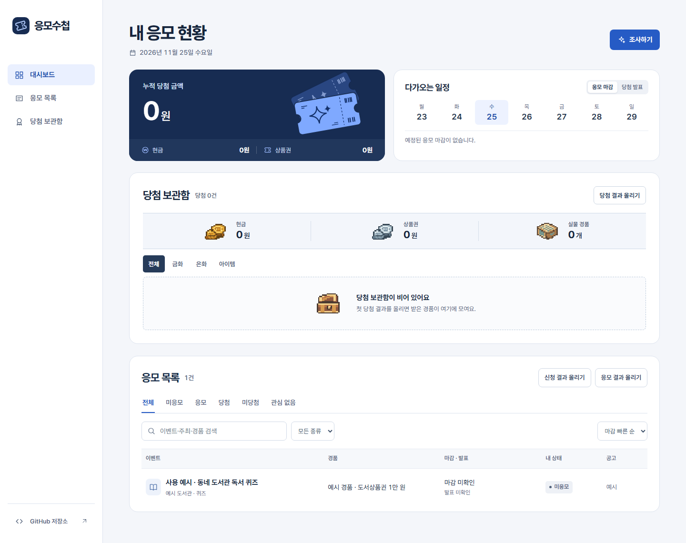

# 응모수첩

설문에 응모해 놓고 발표일을 잊은 적이 있다면, 응모수첩에 기록해 두세요. 퀴즈·설문·추첨 이벤트의 경품과 마감일을 살펴보고, 응모한 행사만 골라 당첨 발표를 확인할 수 있는 무료 PC 앱입니다.

[Windows용 ZIP 다운로드](https://github.com/corefactory-cms/giveaway-desk/releases/latest/download/GiveawayDesk-Windows-x64.zip) · [에이전트용 리서치 안내](AGENTS.md) · [입력 파일 형식](research.schema.json)



## 내 PC에서 시작하기

1. 위의 **Windows용 ZIP**을 내려받아 폴더에 압축을 풉니다.
2. **실행.cmd**를 더블클릭합니다. Windows 10·11의 64비트(x64) PC에서는 Python을 따로 설치할 필요가 없습니다.
3. 브라우저에 열린 **사용 예시 · 동네 도서관 독서 퀴즈**를 눌러 행사 설명과 메모 칸을 살펴보세요. 목록에서 예시를 숨기려면 상태를 **관심 없음**으로 바꾸세요.
4. **조사하기**에서 **피클 · 클로드 · 지피티 · 제미나이** 중 하나를 누르면 해당 AI에 보낼 요청문이 복사됩니다. 채팅에 붙여넣고, 받은 파일을 **조사 결과 파일 가져오기**로 여세요.

첫 실행 목록에는 사용법을 보여주는 가상 예시 한 건만 있습니다. 실제 행사는 각자 관심 분야에 맞춰 가져올 수 있습니다. 응모 기록과 개인 메모는 이 PC의 계정에 저장됩니다. 당첨 처리한 행사에 실제 받은 현금과 상품권 금액을 입력하면 누적 금액에 반영됩니다.

## 이벤트에 설명 남기기

행사 이름을 누르면 주최 측과 행사 설명, 경품, 응모 방법이 나옵니다. 행사 설명은 리서치 파일의 `description`으로 갱신합니다. 직접 적어 둘 내용은 **내 메모**에 쓰고 **기록 저장**을 누르세요. 예를 들어 “11월 25일 응모, 당첨되면 문자로 안내”처럼 적을 수 있습니다. 공개 공고를 다시 가져와도 내 메모와 응모 상태는 보존됩니다.

## 응모한 뒤, 발표가 난 뒤

- **신청 결과 올리기**를 누르고 AI를 선택하세요. 복사된 요청문과 함께 응모를 완료한 행사 이름이나 접수 확인 내용을 보내세요. 돌려받은 JSON을 이 창에서 열거나 붙여넣고, 미리보기에서 행사명과 상태를 확인해 반영하세요.
- **응모 결과 올리기**에서는 당첨 안내나 본인이 확인한 결과를 같은 방법으로 정리할 수 있습니다. 발표를 아직 확인하지 못한 행사는 응모 상태로 남겨 두세요.
- **당첨 보관함**에는 현금이 금화, 상품권 액면가가 은화, 실물 경품이 이름과 수량이 있는 아이템으로 쌓입니다. 카드에서 행사 상세를 열어 직접 수정할 수도 있습니다. 같은 결과 파일을 다시 올려도 금액이나 수량이 두 번 더해지지 않습니다.

공개 행사 조사에는 [조사 양식](research.schema.json), 개인의 응모·당첨 기록에는 [기록 양식](records.schema.json)을 사용합니다. 피클·Claude·ChatGPT·Gemini에는 사용자가 요청문을 붙여넣을 때 전달됩니다. 기록을 직접 입력하려면 응모 목록에서 행사 이름을 누르세요.

## 피클·Codex·Claude에게 맡기기

웹을 조회하고 이 PC에서 파일이나 명령을 다룰 수 있는 에이전트에게 아래 문장을 그대로 보내세요.

> https://github.com/corefactory-cms/giveaway-desk 의 README와 AGENTS.md를 읽고 내 PC의 응모수첩을 업데이트해 줘. 처음이면 Windows 배포판을 준비해 줘. 오늘 한국 기준으로 누구나 참여할 수 있는 퀴즈·설문·추첨을 검색해. 공식 공고에서 마감일, 경품, 응모 조건과 발표일을 확인하고, 기존 행사와 대조해서 추가하거나 갱신해 줘. 작업 후 새로 추가한 건수, 변경한 건수, 마감이 가까운 행사 3개를 알려 줘. 실제 응모는 내가 할게.

웹 채팅에서 파일을 만들어 받을 때는 마지막에 **“내 PC에서 명령을 실행하는 대신, 응모수첩에 가져올 JSON 파일 한 개를 줘”**라고 덧붙이세요. 앱에서 JSON을 가져오면 같은 방식으로 반영됩니다. 앱 자체에는 유료 AI API 키가 필요하지 않습니다. 사용하는 외부 에이전트의 요금과 사용 한도는 해당 서비스 계정을 따릅니다.

## 소스에서 실행하기

Python 3.10 이상에서 저장소 폴더를 열고 실행합니다. Python 표준 라이브러리만 사용합니다.

```shell
python app.py
```

같은 폴더의 명령으로 리서치 데이터를 확인하고 갱신할 수 있습니다. Windows 배포판에서는 아래의 `python` 대신 `.\runtime\python.exe`를 사용합니다.

```shell
python agent.py paths
python agent.py catalog
python agent.py validate updates.json
python agent.py import updates.json
```

Windows의 기본 데이터 폴더는 `%LOCALAPPDATA%\GiveawayDesk`입니다. 다른 폴더를 쓰려면 실행 전에 `GIVEAWAY_DESK_HOME`을 지정하세요. 새 버전을 다른 폴더에 풀어도 같은 사용자 계정과 데이터 위치를 쓰면 기존 기록을 계속 볼 수 있습니다.

## 라이선스

프로그램 소스는 [MIT 라이선스](LICENSE)로 배포합니다. Windows 배포본에는 Python 런타임과 해당 라이선스가 함께 들어 있습니다. 각 행사 주최 측의 최신 참가 조건과 경품 안내는 앱에서 연결한 원문을 확인해 주세요.

화면 구성은 [shadcn/ui 대시보드](https://ui.shadcn.com/blocks/dashboard)와 [Tabler 대시보드](https://github.com/tabler/tabler)를 참고했습니다. 메뉴·목록·입력창에 쓰는 [프리텐다드](https://github.com/orioncactus/pretendard)는 앱에 포함돼 있어 인터넷 연결 없이도 표시됩니다. [글꼴 및 런타임 라이선스](THIRD_PARTY_NOTICES.md)
